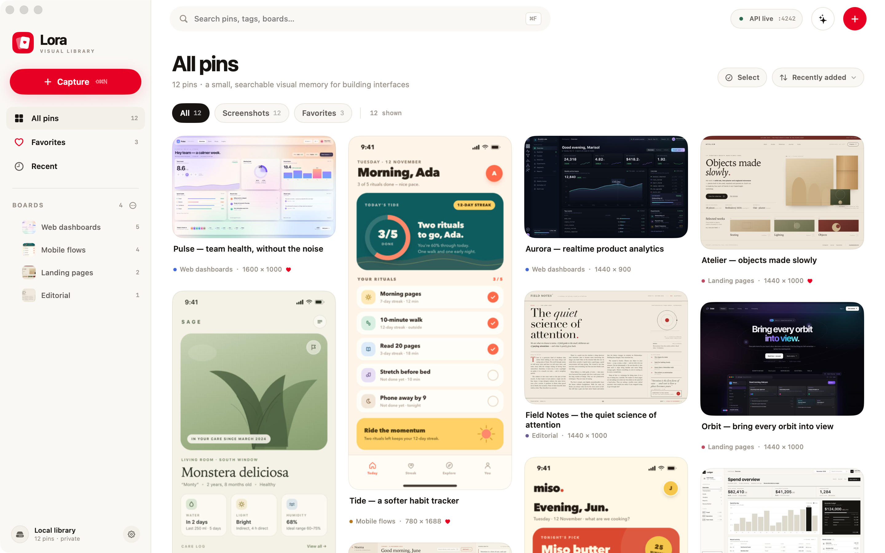
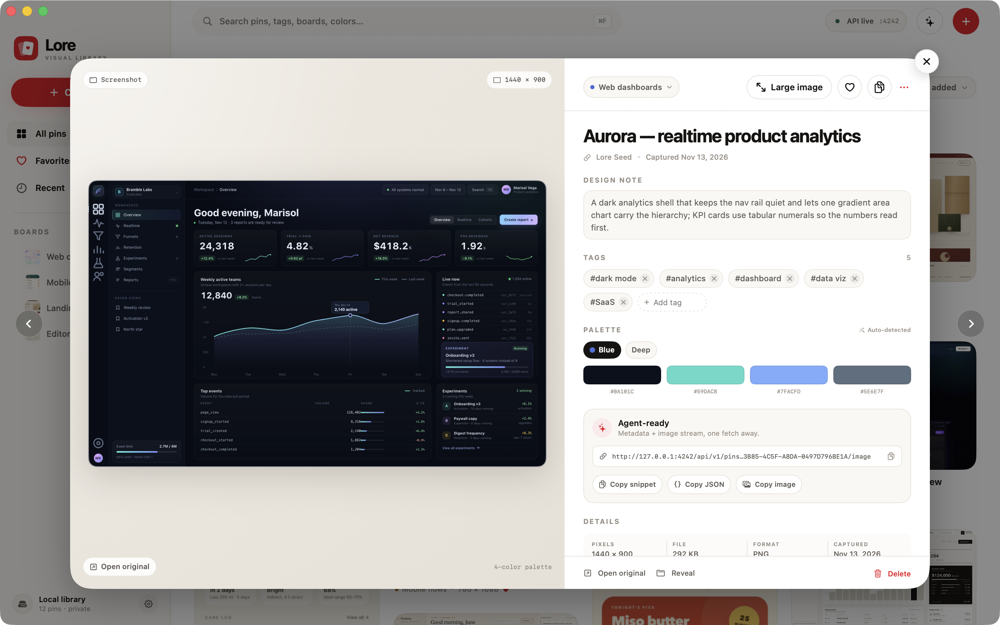
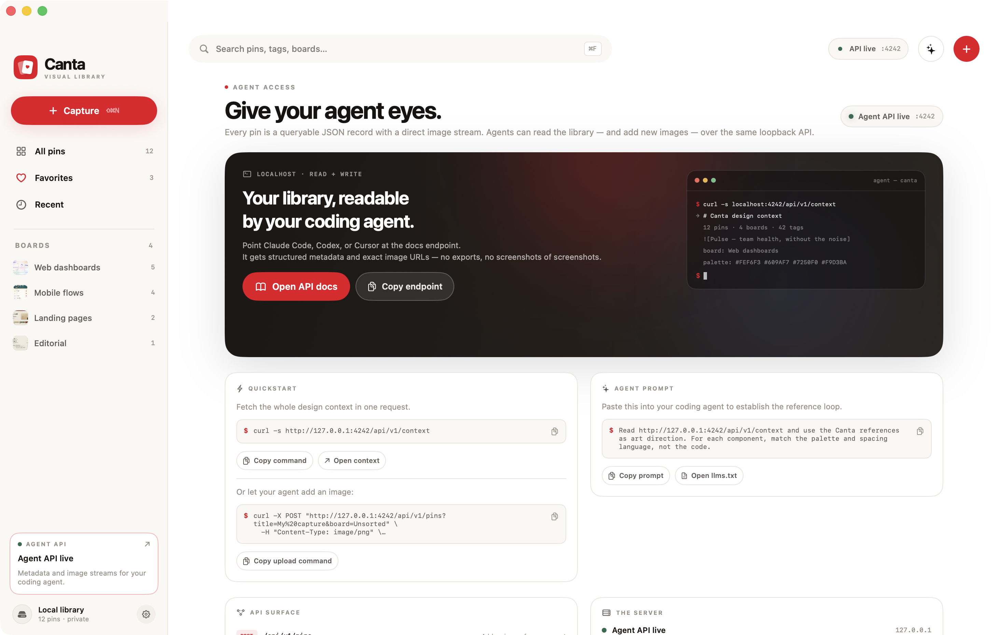
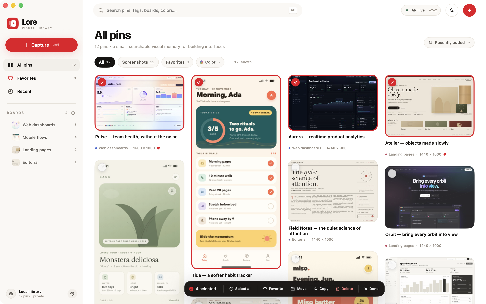
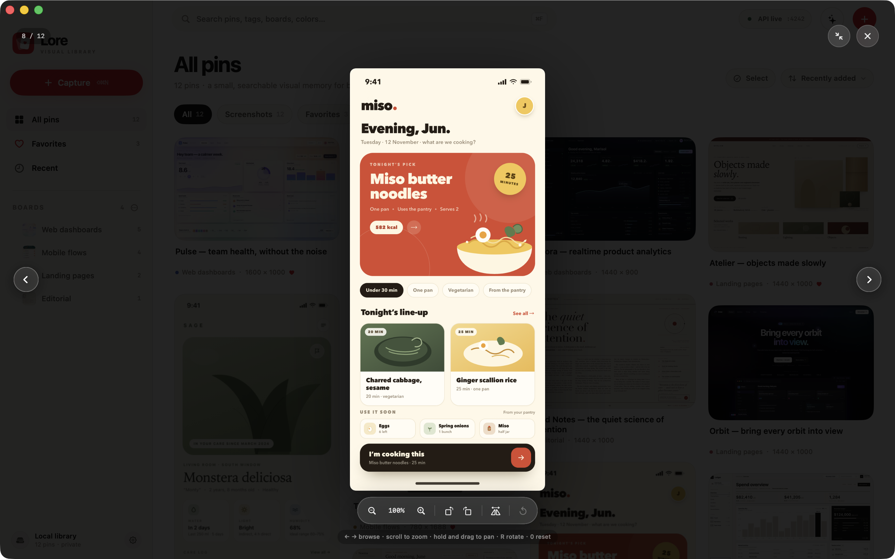
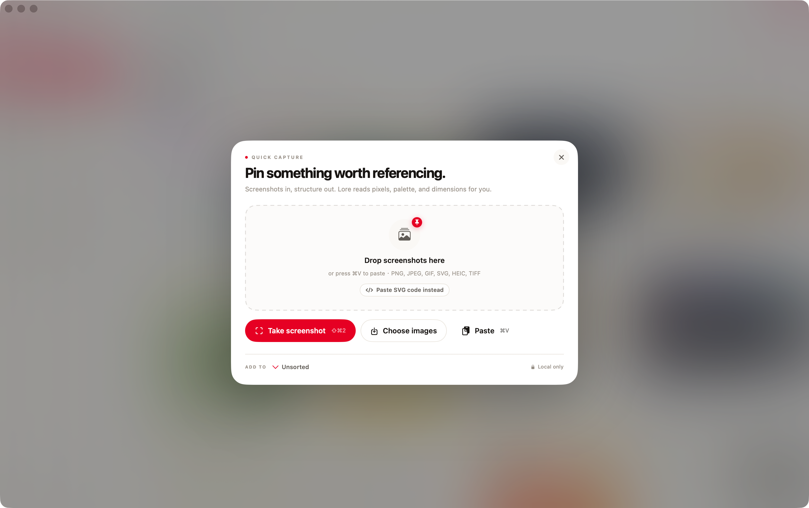
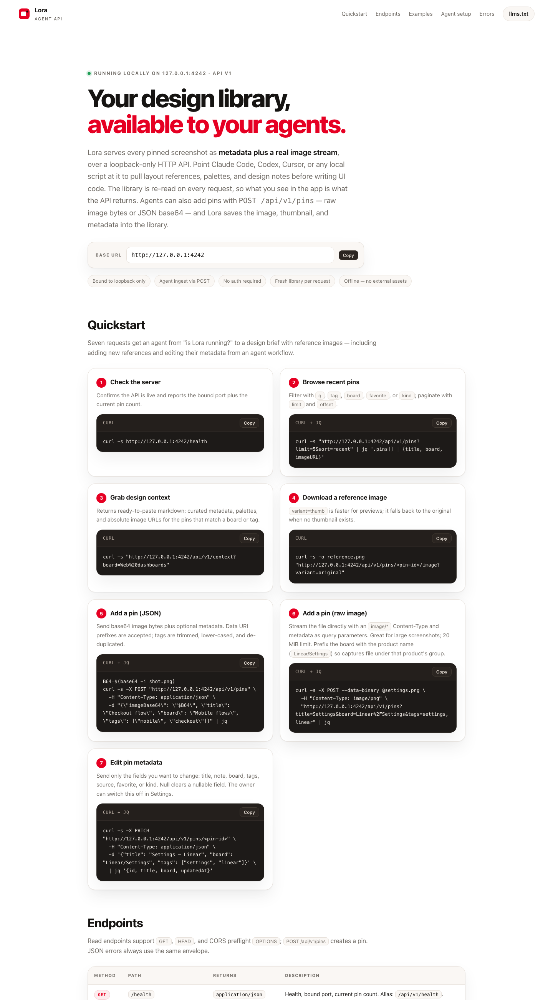

# Lore

[简体中文](README.md) · **English**

**A quiet visual library for humans and their agents.**

Lore is a native macOS app for capturing UI screenshots, keeping them in a Pinterest-style gallery, layering on useful metadata, and serving the whole library to coding agents over a loopback HTTP API. Pin an interface you like, and your agent can fetch its palette, dimensions, tags, and an exact image stream while it builds the next screen.



<p align="center">
  
  
</p>

## Why Lore

Design reference usually lives in a messy folder of screenshots, a chat thread, or a dozen browser tabs. Agents can't see any of it. Lore is a small, local-first memory for visual taste:

- **Fast to capture** — drag files in, paste from the clipboard (⇧⌘V), or grab a screen region (⇧⌘2).
- **Pinterest, but for references** — a balanced masonry gallery with hover save, boards, search, and favorites.
- **Metadata that matters** — editable titles, design notes, tags, boards, source attribution, dimensions, file size, dominant palette, and timestamps.
- **GIF support** — import, drop, paste, or upload a GIF through the Agent API and the original animation is preserved. Cards play it on hover, the detail card and large-image mode keep it looping, and the API exposes `animated` and `frameCount`.
- **Automatic color families** — every pin is analysed into multi-valued hue families (blue, teal, green, yellow, red, violet, pink, brown, neutral, multicolor) plus a tone (light, pastel, vivid, muted, deep). The gallery filters by both, agents can query `color` and `tone`, and older pins are backfilled in the background.
- **Agent-readable by default** — a localhost API exposes enriched JSON plus original/thumbnail image streams, Markdown design context, an OpenAPI 3.1 spec, llms.txt, and an in-app documentation site. Agents can also add images back into the library.
- **Agent-editable metadata** — agents can also update titles, notes, boards, tags, and favorites through `PATCH /api/v1/pins/{id}`; a Settings switch can disable it.
- **Hierarchical boards** — board names containing `/` group into collapsible groups in the sidebar, so `Linear/Settings` files under `Linear`; agents should prefix captures with the product name (e.g. `board=Linear/Settings`).
- **Board management** — right-click a board in the sidebar to rename it inline (Enter saves, Esc cancels); the button beside *Boards* opens a manager to rename a board or a whole group (sub-boards follow), merge by renaming onto an existing board, or delete a board and re-file its pins under Unsorted while keeping every image.
- **Batch work** — enter selection mode to favorite, move, copy agent context, or delete several cards at once; right-click a single card for a confirmed quick delete.
- **Large image & keyboard browsing** — open a pin, then single-click the image to switch to image-only mode; a floating toolbar and keyboard shortcuts handle zoom, pan, rotate, mirror, and reset; use ← / → to move between pins and Esc to go back. Right-click the image to copy it.
- **Hand-cursor details** — cards, buttons, menus, switches, and every other clickable control use the pointing-hand cursor.
- **Window gestures** — double-click the empty title-bar strip beside the traffic lights, or the empty stretch of the toolbar between the search field and the API status pill, to zoom/restore the window with a smooth eased animation; double-clicks everywhere else keep their own meaning.
- **Local and private** — images and metadata stay on this Mac. The server binds only to 127.0.0.1.

## Capture

| Action | Shortcut |
| --- | --- |
| Quick capture sheet | ⌘N |
| Import images | ⌘O |
| Paste image from clipboard | ⇧⌘V |
| Capture a screen region | ⇧⌘2 |
| Search pins | ⌘F |
| Open Agent access | ⌘4 |
| Select multiple cards | ⌘B |
| Previous / next pin in detail | ← / → |
| Enter image-only mode (detail) | Click the image or the “Large image” button |
| Large image: zoom in / out | + / - |
| Large image: rotate right / left 90° | R / ⇧R |
| Large image: mirror horizontally | M |
| Large image: reset view | 0 |
| Large image: pan the image | Drag the image |
| Large image: toggle between fit and 250% | Double-click image |
| Large image: copy the image | Right-click image → “Copy image” |

### Batch selection & large image

<p align="center">
  
  
</p>

In selection mode, cards get a check circle and the bottom bar can select all, favorite, move to a board, copy agent context, or delete in one action. In any pin detail, single-click the image (or the **Large image** button) for an image-only view; the floating toolbar along the bottom offers zoom out, the zoom percentage (100% fits the window), zoom in, rotate left/right 90°, mirror horizontally, and reset view, with a one-line gesture hint beneath it. Scroll or pinch to zoom, drag the image to pan once zoomed in, and double-click to toggle between fit and 250%; on the keyboard, + / - zoom, R rotates right, ⇧R rotates left, M mirrors horizontally, 0 resets the view, ← / → move between pins, and Esc goes back. Right-click the image to copy the original.



You can also drop files anywhere on the window. Lore reads pixel dimensions, file size, and a five-color palette automatically (GIFs keep their animation and frame count), then classifies searchable color families and tone; titles are derived from filenames and can be edited in the pin close-up.

> Screen region capture uses macOS's built-in `screencapture -i`. The first run may ask for Screen Recording permission.

## Agent access

By default the API runs at **http://127.0.0.1:4242** while Lore is open.

```bash
# Full, enriched library JSON
curl -s http://127.0.0.1:4242/api/v1/library | jq

# Filter pins
curl -s "http://127.0.0.1:4242/api/v1/pins?board=Web%20dashboards&favorite=true" | jq

# Upload an animated GIF
curl -s -X POST --data-binary @loading.gif \
  -H "Content-Type: image/gif" \
  "http://127.0.0.1:4242/api/v1/pins?title=Loading%20loop&board=Mobile%20flows&kind=image" | jq

# Filter by colour family and tone (or color=multicolor)
curl -s "http://127.0.0.1:4242/api/v1/pins?color=teal&tone=deep" | jq

# Markdown context — paste straight into an agent prompt
curl -s http://127.0.0.1:4242/api/v1/context

# Let an agent add an image (raw upload)
curl -X POST "http://127.0.0.1:4242/api/v1/pins?title=Agent%20capture&board=Unsorted" \
  -H "Content-Type: image/png" \
  --data-binary @screenshot.png

# Or send JSON + base64
curl -X POST http://127.0.0.1:4242/api/v1/pins \
  -H "Content-Type: application/json" \
  -d '{"imageBase64":"...","title":"Agent capture","tags":["landing","dark"]}'

# Let an agent update an existing pin's metadata
curl -X PATCH "http://127.0.0.1:4242/api/v1/pins/<pin-id>" \
  -H "Content-Type: application/json" \
  -d '{"title":"Settings — Linear","board":"Linear/Settings","tags":["settings"]}'

# Open the documentation site
open http://127.0.0.1:4242/docs
```

Agents can update a pin's title, note, board, tags, source, favorite, and kind with `PATCH /api/v1/pins/{id}`; turn this off in **Settings → Agent API → Allow metadata edits**.

Each pin exposes `imageURL` and `thumbnailURL` fields that stream raw bytes, so an agent can inspect the reference itself, not just its description.

When an agent adds screenshots, prefix the board with the product name, e.g. `board=Linear/Settings` — Lore groups them under `Linear` in the sidebar. On raw uploads, encode the slash in the query string as `%2F`.

Discovery endpoints:

- `/docs` — styled documentation for humans and agents
- `/openapi.json` — OpenAPI 3.1 specification
- `/llms.txt` — compact machine-readable index
- `/api/v1/context` — Markdown design context for prompting
- `POST /api/v1/pins` — image ingest (raw image or JSON base64)
- `PATCH /api/v1/pins/{id}` — agent metadata updates (title, note, board, tags, source, favorite, kind)

The server can be stopped, restarted, or moved to another port from **Agent access** in the sidebar or **Settings**. The offline HTML docs at `/docs` are a first-class surface:

[](docs/screenshots/api-docs.png)

A full reference also lives in [docs/AGENT_API.md](docs/AGENT_API.md).

## Build and run

Requirements: macOS 14 or newer, Swift 6 toolchain (Command Line Tools or Xcode).

```bash
./scripts/build-app.sh release
open dist/Lore.app
```

The build script bundles the SwiftPM resource bundle, generates the app icon from the 1024 px master, writes `Info.plist`, and ad-hoc signs `dist/Lore.app`.

The icon master `Sources/Lore/Resources/AppIcon/icon_1024.png` is drawn by `scripts/make-app-icon.py` from the same geometry as the in-app `LoreMark`, so the Dock icon and the app's own brand mark stay one artwork.

For day-to-day development:

```bash
swift build
swift run Lore
```

On a bare Command Line Tools install (no Xcode), SwiftPM's nested sandbox can be blocked by the host sandbox. Use:

```bash
export CLANG_MODULE_CACHE_PATH="$PWD/.build/cache/clang"
export SWIFT_MODULECACHE_PATH="$PWD/.build/cache/swift"
swift build --disable-sandbox --manifest-cache local --cache-path .build/spm-cache --scratch-path .build
```

## Data model

Everything is plain files under:

```
~/Library/Application Support/Lore/
├── library.json      # pins + metadata
├── Images/           # original captures
├── Thumbnails/       # 1200 px JPEG previews (detail / agent)
└── Cards/            # 640 px JPEG grid thumbnails (generated on import; backfilled in the background for older libraries)
```

`library.json` is the single source of truth and is re-read by the API on every request. The schema is documented in [docs/AGENT_API.md](docs/AGENT_API.md). Set `LORE_HOME` to point the app at a different library for development.

## Project structure

```
Sources/
├── Lore/                      SwiftUI macOS app
│   ├── LoreApp.swift          app entry, commands, menus
│   ├── Design/                 theme, components, image loading
│   ├── Localization/           English + Simplified Chinese strings
│   ├── Store/                  persistence, image processing, seed library
│   └── Views/                  gallery, pin close-up, capture, agent access
├── LoreAgentKit/              loopback HTTP API, docs, OpenAPI, llms.txt
└── Lore/Resources/Seed/       designed sample library (HTML-rendered PNGs)
Tests/                          API tests
docs/                           API reference + screenshots
scripts/                        packaging and screenshot helpers
```

The API target has no third-party dependencies; it uses Network.framework and Foundation. The app uses SwiftUI, AppKit, ImageIO, and UniformTypeIdentifiers.

## Design language

Lore borrows Pinterest's confidence — image-first cards, generous white space, a signature red, and a masonry that never feels mechanical — then warms it into a library: paper-toned surfaces, editorial type, quieter motion, and metadata that is always one click away.

The app's red is `#E60023`; the canvas is paper white with warm parchment wells. Cards use 18 px continuous radii, the pin close-up uses a 30 px radius, and all state changes favor short, eased springs.

## Language

Lore ships with **English** and **Simplified Chinese** interfaces. It follows the macOS system language by default; open **Settings → Language** to switch at any time. The choice is remembered.

## Verification

- `./scripts/build-app.sh release` produces the self-contained app bundle.
- `./scripts/perf-bench/run.sh` reproduces the pre-optimization data-layer baseline; `Lore --bench` prints query/encode/decode timings of the current implementation for a real library.
- `./scripts/perf-guard.sh --pins 5000` runs the data-layer performance gate (1k/5k budgets).
- The Agent API has a black-box smoke suite with a temporary fixture library:

  ```bash
  ./scripts/agent-smoke-test.sh
  ```

  It starts the real server on an ephemeral port and checks every endpoint family, JSON/raw image uploads, metadata PATCH updates (including null clearing, board moves, validation failures, unknown pins, and the disabled-editing 403), HEAD/OPTIONS/CORS behavior, JSON shape, filters, image bytes, and traversal protection (192 checks).
- The Swift Testing suite in `Tests/LoreAgentKitTests` contains 49 tests. Executing it requires Xcode's XCTest runner; the Command Line Tools-only environment here compiles the suite but cannot run it, so the smoke test is the authoritative local check.
- Automated screenshots are reproducible with `./scripts/screenshot-app.sh gallery|agent|capture|detail|batch|large`; set `SCREENSHOT_LANG=en|zh` to capture either language.

## Status

Lore 1.1 is a complete, local-first macOS app. The seed library is designed from scratch and rendered from hand-written HTML/CSS; no external assets or network requests are used at runtime.