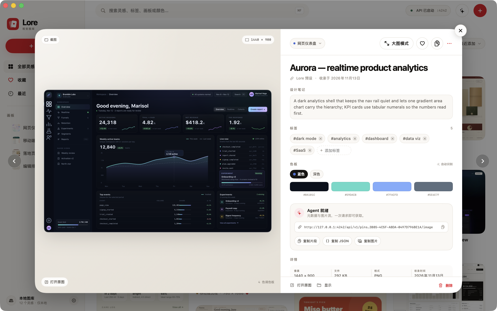
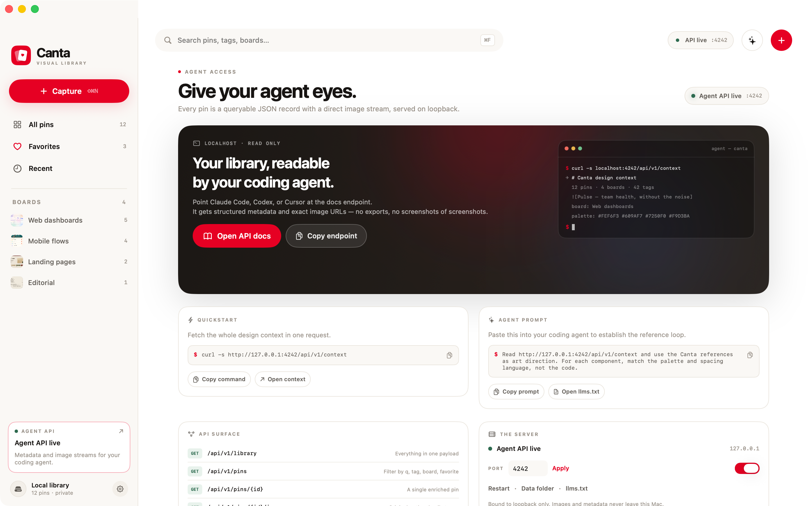
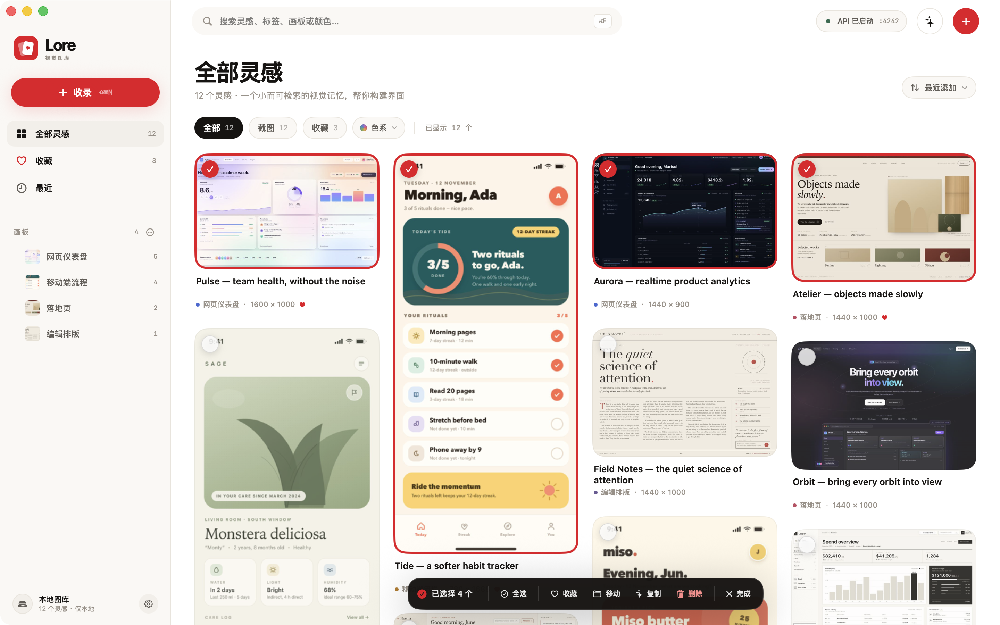
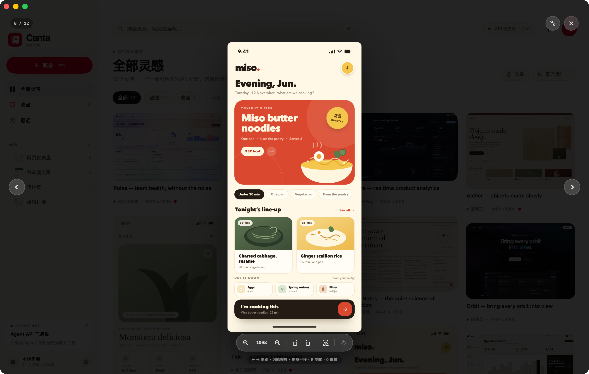
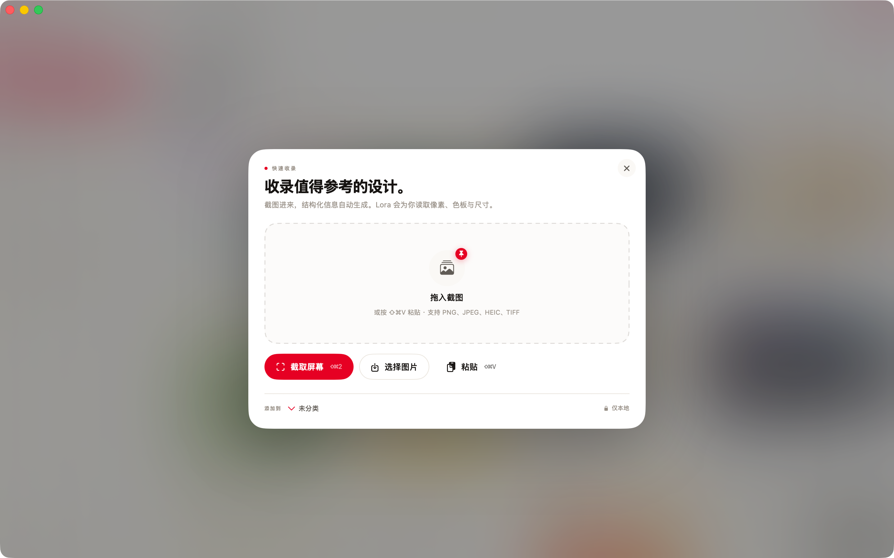
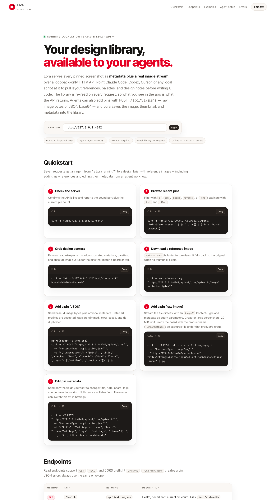

# Lora

**简体中文** · [English](README.en.md)

**属于人类与 Agent 的安静视觉图库。**

Lora 是一个原生 macOS 应用，用来快速收录 UI 截图、在 Pinterest 风格的画廊中浏览、补充有用元数据，并通过本地 HTTP API 把整个图库变成编程 Agent 可读取的设计参考。收藏一个喜欢的界面，Agent 就能在写下一个屏幕时获取它的色板、尺寸、标签和原图。


<p align="center">
  
  
</p>

## 为什么是 Lora

设计参考通常散落在截图文件夹、聊天记录或十几个浏览器标签页里。Agent 看不到这些东西。Lora 是一个小巧、本地优先的“视觉品味记忆”：

- **快速收录**：拖入文件、粘贴剪贴板（⇧⌘V），或截取屏幕区域（⇧⌘2）。
- **属于参考的 Pinterest**：平衡的瀑布流画廊，悬停收藏、画板、搜索、最近添加与收藏夹。
- **有用的元数据**：可编辑标题、设计笔记、标签、画板、来源、尺寸、文件大小、主色板与时间。
- **默认对 Agent 友好**：本地 API 提供增强 JSON、原图/缩略图流、Markdown 设计上下文、OpenAPI 3.1、`llms.txt`，以及应用内文档页；Agent 也可以反向写入图片。
- **可回写元数据**：Agent 还能通过 `PATCH /api/v1/pins/{id}` 修改标题、笔记、画板、标签、收藏等元数据；设置里可以关闭这项能力。
- **层级画板**：画板名用 `/` 分组，例如 `Linear/Settings` 会在侧栏归入可折叠的 `Linear` 组；Agent 收录截图时以产品名为前缀，归档更整齐。
- **画板管理**：侧栏「画板」旁的管理按钮可重命名画板或整个分组（子画板一起改名）；把名称改成已有画板即可合并；删除画板时其中的灵感会移回未分类，原图与元数据都保留。
- **本地且私密**：图片和元数据始终留在这台 Mac 上，服务只绑定 `127.0.0.1`。
- **批量整理**：进入选择模式后可一次收藏、移动画板、复制 Agent 上下文或删除多张卡片；右键单张卡片也可快速删除（带确认）。
- **大图与键盘浏览**：详情中单击图片即可进入只看图片的大图模式；浮动工具栏与快捷键可缩放、平移、旋转、镜像和重置视图，← → 切换上一张/下一张，Esc 返回；在大图上右键可直接复制原图。
- **手型光标细节**：卡片、按钮、菜单、开关等所有可点击元素统一使用手型光标。
- **窗口快捷手势**：双击窗口左上角交通灯右侧的标题栏空白处，或双击顶部工具条中搜索框与 API 状态胶囊之间的空白处，可带缓动动画地在最大化与原始窗口位置之间切换；其他区域的双击仍保持原有含义。
- **中英双语**：默认跟随 macOS 系统语言，可在设置中随时切换中文或 English。

## 快速收录

| 操作 | 快捷键 |
| --- | --- |
| 打开快速收录面板 | ⌘N |
| 导入图片 | ⌘O |
| 粘贴剪贴板图片 | ⇧⌘V |
| 截取屏幕区域 | ⇧⌘2 |
| 搜索灵感 | ⌘F |
| 打开 Agent 访问 | ⌘4 |
| 批量选择卡片 | ⌘B |
| 详情中切换上一张 / 下一张 | ← / → |
| 进入大图模式（详情中） | 单击图片或点击「大图模式」 |
| 大图模式：放大 / 缩小 | + / - |
| 大图模式：向右 / 向左旋转 90° | R / ⇧R |
| 大图模式：水平镜像 | M |
| 大图模式：重置视图 | 0 |
| 大图模式：平移图片 | 拖动图片 |
| 大图模式：在适应窗口与 250% 间切换 | 双击图片 |
| 大图模式：复制图片 | 右键图片 →「复制图片」 |

### 批量选择与大图

<p align="center">
  
  
</p>

在选择模式下，卡片会被加上选择圈；底部操作条可一键全选、收藏、移动画板、复制 Agent 上下文或删除。打开任一详情后，单击图片（或点击右上角「大图模式」）即可进入纯图片视图；底部浮动工具栏从左到右提供缩小、缩放比例（100% 即适应窗口）、放大、向左/向右旋转 90°、水平镜像与重置视图，下方有一行手势提示。滚轮或触控板捏合可缩放，放大后拖动图片平移，双击在适应窗口与 250% 之间切换；键盘上 + / - 缩放，R 向右旋转、⇧R 向左旋转，M 水平镜像，0 重置视图，← / → 切换上一张 / 下一张，Esc 返回；在大图上右键图片可复制原图。



也可以把文件拖到窗口任意位置。Lora 会自动读取像素尺寸、文件大小和最多五色调色板；标题由文件名生成，可在灵感详情中修改。

> 区域截图使用 macOS 自带的 `screencapture -i`。首次使用时系统可能请求屏幕录制权限。

## Agent 接入

应用运行时，API 默认位于 **http://127.0.0.1:4242**。

```bash
# 获取整个增强图库 JSON
curl -s http://127.0.0.1:4242/api/v1/library | jq

# 筛选灵感
curl -s "http://127.0.0.1:4242/api/v1/pins?board=Web%20dashboards&favorite=true" | jq

# 获取可直接粘贴给 Agent 的 Markdown 设计上下文
curl -s http://127.0.0.1:4242/api/v1/context

# 让 Agent 直接添加一张图片（原始图片上传）
curl -X POST "http://127.0.0.1:4242/api/v1/pins?title=Agent%20capture&board=Unsorted" \
  -H "Content-Type: image/png" \
  --data-binary @screenshot.png

# 或者使用 JSON + base64
curl -X POST http://127.0.0.1:4242/api/v1/pins \
  -H "Content-Type: application/json" \
  -d '{"imageBase64":"...","title":"Agent capture","tags":["landing","dark"]}'

# 让 Agent 更新已有灵感的元数据
curl -X PATCH "http://127.0.0.1:4242/api/v1/pins/<pin-id>" \
  -H "Content-Type: application/json" \
  -d '{"title":"Settings — Linear","board":"Linear/Settings","tags":["settings"]}'

# 打开文档站
open http://127.0.0.1:4242/docs
```

Agent 可以通过 `PATCH /api/v1/pins/{id}` 更新已有灵感的标题、笔记、画板、标签、来源、收藏与类型；这项能力可以在 **设置 → Agent API → 允许修改元数据** 中关闭。

每个灵感都包含 `imageURL` 和 `thumbnailURL`，Agent 可以直接读取真实图片，而不只是阅读描述。

Agent 添加截图时，建议把画板名写成「产品/界面」，例如 `board=Linear/Settings`——Lora 会把它归到侧栏的 `Linear` 组下。原始图片上传时，查询串里的斜杠要写成 `%2F`。

发现端点：

- `/docs` — 供人与 Agent 阅读的样式化文档
- `/openapi.json` — OpenAPI 3.1 规范
- `/llms.txt` — 供机器读取的索引
- `/api/v1/context` — 用于提示词的 Markdown 设计上下文
- `POST /api/v1/pins` — Agent 添加图片（原始图片或 JSON base64）
- `PATCH /api/v1/pins/{id}` — Agent 更新灵感元数据（标题、笔记、画板、标签、来源、收藏、类型）

服务可以在侧栏的 **Agent 访问** 或 **设置** 中停止、重启或更换端口。`/docs` 是应用内的一等界面：

[](docs/screenshots/api-docs.png)

完整参考见 [docs/AGENT_API.md](docs/AGENT_API.md)。

## 构建与运行

要求：macOS 14 或更新版本，Swift 6 工具链（Xcode 或 Command Line Tools）。

```bash
./scripts/build-app.sh release
open dist/Lora.app
```

构建脚本会打包 SwiftPM 资源包、用 1024px 母版生成应用图标、写入 `Info.plist`，并对 `dist/Lora.app` 做 ad-hoc 签名。

应用图标母版 `Sources/Lora/Resources/AppIcon/icon_1024.png` 由 `scripts/make-app-icon.py` 绘制，几何参数与应用内的 `LoraMark` 一致，所以 Dock 里的图标和侧栏品牌标记是同一套图形。

日常开发：

```bash
swift build
swift run Lora
```

在只有 Command Line Tools（无 Xcode）的机器上，SwiftPM 的嵌套沙盒可能被宿主沙盒拦截，可以这样构建：

```bash
export CLANG_MODULE_CACHE_PATH="$PWD/.build/cache/clang"
export SWIFT_MODULECACHE_PATH="$PWD/.build/cache/swift"
swift build --disable-sandbox --manifest-cache local --cache-path .build/spm-cache --scratch-path .build
```

## 数据模型

所有内容都是普通文件，保存在：

```
~/Library/Application Support/Lora/
├── library.json      # 灵感与元数据
├── Images/           # 原始截图
├── Thumbnails/       # 1200px JPEG 缩略图（详情/Agent）
└── Cards/            # 640px JPEG 网格缩略图（导入时生成，旧库首次启动后台补齐）
```

`library.json` 是唯一数据源，API 每次请求都会重新读取。字段定义见 [docs/AGENT_API.md](docs/AGENT_API.md)。开发时可通过 `LORA_HOME` 指向其他图库。

## 项目结构

```
Sources/
├── Lora/                      SwiftUI macOS 应用
│   ├── LoraApp.swift          应用入口、命令、菜单
│   ├── Design/                 主题、组件、图片加载
│   ├── Localization/           中英文本地化
│   ├── Store/                  持久化、图片处理、种子图库
│   └── Views/                  画廊、详情、快速收录、Agent 访问
├── LoraAgentKit/              本地 HTTP API、文档、OpenAPI、llms.txt
└── Lora/Resources/Seed/       HTML 渲染的示例图库
Tests/                          API 测试
docs/                           API 参考与截图
scripts/                        打包与截图脚本
```

API 目标没有第三方依赖，只使用 Network.framework 与 Foundation；应用使用 SwiftUI、AppKit、ImageIO 和 UniformTypeIdentifiers。

## 设计语言

Lora 借用了 Pinterest 的自信——图片优先、留白充分、标志性的红色、不会显得机械的瀑布流——再把它变成一座更温暖的图库：纸张质感的表面、编辑感的字体、克制的动效，以及随时可触达的元数据。

应用的主红色为 `#E60023`；画布是纸白色，搭配温暖的羊皮纸色块。卡片使用 18px 连续圆角，详情浮层使用 30px 圆角，状态切换采用短促的缓动弹簧。

## 语言

应用内置 **简体中文** 与 **English** 两套界面。默认跟随 macOS 系统语言；在 **设置 → 语言** 中可随时切换，选择会被记住。界面切换立即生效。

## 验证

- `./scripts/build-app.sh release` 生成自包含的应用包。
- `./scripts/perf-bench/run.sh` 复现优化前的数据层基线（对照用）；`Lora --bench` 在真实图库上打印当前实现的查询/编码/解码耗时。
- `./scripts/perf-guard.sh --pins 5000` 运行数据层性能门禁（1k/5k 预算断言）。
- Agent API 有一套黑盒冒烟测试，使用临时 fixture 图库：

  ```bash
  ./scripts/agent-smoke-test.sh
  ```

  脚本会在临时端口启动真实服务，覆盖所有端点族、JSON/原始图片上传、元数据 PATCH 更新（含空值清除、画板移动、校验失败、未知灵感、关闭修改后的 403）、HEAD/OPTIONS/CORS 行为、JSON 结构、筛选、图片字节与路径穿越防护（共 192 项检查）。
- `Tests/LoraAgentKitTests` 中有 49 个 Swift Testing 用例。在本机纯 Command Line Tools 环境下编译通过，但缺少 XCTest runner 无法执行；因此上述 smoke test 是本地权威验证。
- 截图可复现：`./scripts/screenshot-app.sh gallery|agent|capture|detail|batch|large`，支持 `SCREENSHOT_LANG=en|zh`。

## 状态

Lora 1.0 是一个完整的本地优先 macOS 应用。示例图库全部由手写 HTML/CSS 渲染生成，运行时不请求任何外部资源或网络。