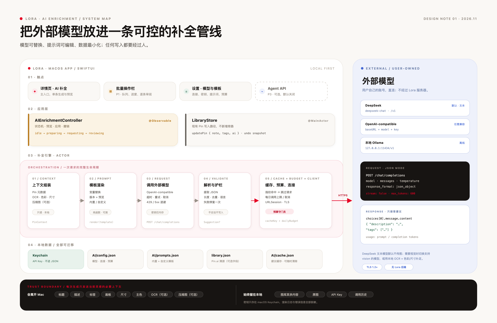
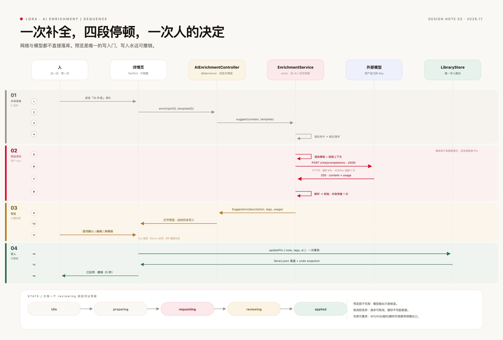
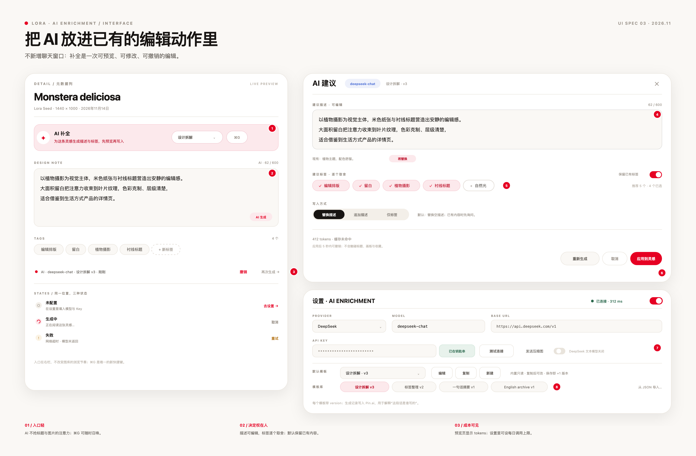

# Lore AI 补全设计

为灵感自动生成描述（Design note）与标签，支持配置外部模型与提示词模板。

**飞书文档**：[Lore AI 补全设计方案](https://rcnpx636fedp.feishu.cn/docx/KXd9dKFrCoXdrlxRZG7cyHUvnHc)

> 本文是设计提案，不包含实现代码。文档已通过 `lark-cli` 创建为飞书云文档，并嵌入下方三张设计图。

## 一句话方案

在 Lore 内嵌一个可配置的“补全器”：调用用户自己的外部模型（默认 DeepSeek），按可编辑的提示词模板，为单条灵感生成描述与标签；结果先进入预览，确认后才写库，写入可撤销。

## 设计图

### 系统边界

- 外部模型在右侧，密钥与图库在本地；只有当前灵感的必要上下文跨过信任边界。
- 引擎是一个 actor：上下文组装 → 模板渲染 → 请求 → 解析/护栏 → 缓存与预算。
- 写入只经过 `LibraryStore.updatePin`，不另开旁路。

### 一次补全的时序

- 四个停顿点：本地准备、网络请求、人工预览、原子写入。
- 缓存命中可跳过网络；`reviewing` 是唯一能写库的状态。
- 取消即丢弃，失败不产生半条数据；应用后 5 秒内可撤销。

### 界面与交互

1. 详情页 note 上方是入口，⌘G 唤起；结果直接落进 note 与 tags。
2. 预览弹窗里描述可编辑、标签可逐个取舍，应用前不写库。
3. 设置页管理模型、Keychain、视觉开关与模板库；内置模板只读，复制后可改。

## 关键决策

| 决策 | 选择 | 原因 |
| --- | --- | --- |
| description 字段 | 复用现有 `note` | 避免搜索/导出/Agent API 三套并行语义 |
| 调用方式 | 客户端直连 OpenAI-compatible API | 无后端、用户自己的 Key、成本归用户 |
| 输出格式 | JSON mode + 一次修复重试 | 比自由文本稳定，解析失败仍不写入 |
| 安全边界 | 预览是唯一写入门；Keychain 存 Key | 模型会误解画面，自动写入伤害信任 |
| 图片 | 默认不发；文本模型用本地 OCR/色彩/尺寸补足 | 兼容 DeepSeek 文本模型，降低隐私与成本 |
| 模板 | 内置只读 + 自定义副本 + version | 可调整而不发版，生成记录可解释 |

## 方案要点

- **模型配置**：DeepSeek、OpenAI-compatible、本地 Ollama；base URL、模型、温度、超时、重试、每日调用上限。
- **密钥**：macOS Keychain，`apiKeyRef` 只存引用；日志、错误、配置全部脱敏。
- **提示词模板**：变量白名单（title/note/tags/board/colors/dimensions/source/ocr/tagVocabulary/language/maxTags），保存前校验，生成前可预览渲染结果。
- **输出校验**：提取 JSON、标签规范化、长度/数量校验；失败修复一次，仍失败只展示原文、不可应用。
- **溯源**：`Pin.ai` 记录 provider、model、template/version、生成时间、usage；不升级 library version。
- **成本**：默认每日 50 次成功调用；预览显示 tokens；批量先预检。
- **Agent API（P3，可选）**：`POST /api/v1/pins/{id}/enrich`，默认关闭，共享预算与缓存。

## 落地顺序

| 阶段 | 范围 |
| --- | --- |
| P0 | 模型配置 + Keychain + DeepSeek + 1 个内置模板 + 单条预览/应用/撤销 + 错误映射 + 单测 |
| P1 | 模板编辑器、4 个内置模板、缓存、批量补全、capture toast、预算与用量、中英文文案 |
| P2 | Vision/OCR 完善、标签词表、用量面板、多供应商 profile、模板导入/导出 |
| P3 | Agent API enrich 端点、OpenAPI/llms.txt/docs、独立限流与开关 |

## 文件

- `assets/architecture.svg` / `.png`：系统边界图
- `assets/flow.svg` / `.png`：时序图
- `assets/ui.svg` / `.png`：界面设计图
- `feishu-draft/draft.xml`：飞书文档的 DocxXML 源文件（用于更新/复用）

## 待确认

- 是否在同一管线生成标题？当前建议不做，保持“标题由人命名”。
- 标签语言是否跟随画板，而不是全局？
- 是否支持流式输出？P1 之后再评估。
- 是否内置供应商价格表？建议只显示 tokens，或让用户填单价。
